  <a href="https://patjeyms.dev"><b>patjeyms.dev</b></a> &nbsp;·&nbsp;
  <a href="https://patjeyms.dev/projects/aniskolar">AniSkolar case study</a> &nbsp;·&nbsp;
  <a href="https://www.linkedin.com/in/patjeyms/">LinkedIn</a> &nbsp;·&nbsp;
  <a href="https://patjeyms.dev/resume.pdf">Résumé</a>

---

### Letter to stakeholders

I'm **Pat** (Patrick James Lauron), an Information Technology student at De La Salle University – Dasmariñas on the Web Development track, graduating in 2027. I build full-stack web apps, and I work as a **backend AI engineer at FlyRank AI**, benchmarking LLMs and retrieval techniques for AI search and ranking.

My biggest build is **[AniSkolar](https://www.aniskolar.com/)**, the scholarship portal my capstone group made for DLSU-D, which I led. Away from the editor I edit video, take photos and serve as a legislative councilor in my college's student government.

The outlook for the coming year is strong. I'm always glad to hear about interesting work in web and AI engineering.

### Financial highlights

| | FY 2026 | |
|:--|--:|:--|
| Cumulative GPA (of 4.00) | **3.64** | First Honors Dean's Lister since 2023 |
| Scholarship offices on AniSkolar | **15** | One system, each office sees only its own scholars |
| Automated tests on AniSkolar | **250** | 210 API + 40 Playwright browser tests |
| Committee members led | **14** | Technical & Media Management, CICS Student Government |
| TOEIC score | **900** | C1 Advanced |

### Review of operations

| | Project | | |
|:--|:--|:--|:--|
| 01 | **[AniSkolar](https://patjeyms.dev/projects/aniskolar)** | Scholarship portal for DLSU-D: applications, renewals, duty hours and messaging for students and 15 offices | [Case study](https://patjeyms.dev/projects/aniskolar) · [Live](https://www.aniskolar.com/) · [Frontend](https://github.com/Lauron-PatrickJames/AniSkolar_Frontend) · [Backend](https://github.com/Lauron-PatrickJames/AniSkolar_Backend) |
| 02 | **[patjeyms.dev](https://patjeyms.dev)** | This portfolio, styled as a vintage annual report, built with Vite and TypeScript | [Live](https://patjeyms.dev) · [Source](https://github.com/Lauron-PatrickJames/patjeyms-portfolio) |

### Products & services

| Division | |
|:--|:--|
| **Web** | React · TypeScript · Node.js · Express · Tailwind CSS · PHP · C# / .NET |
| **AI & data** | Python · LLMs & retrieval · RAG & NLP pipelines · model evaluation · MongoDB |
| **Media** | Video editing · photography · videography · Adobe Creative Suite |
| **Leadership** | Organizational leadership · legislative drafting · committee management |

### Shareholder information

📮 [pjameslauron@gmail.com](mailto:pjameslauron@gmail.com) &nbsp;·&nbsp; 🏢 Bacoor, Cavite, Philippines (open to remote work) &nbsp;·&nbsp; 🗓️ Open to internships, projects & collaborations

Printed in Cavite, Philippines, on the World Wide Web. Figures as of November 2026.
